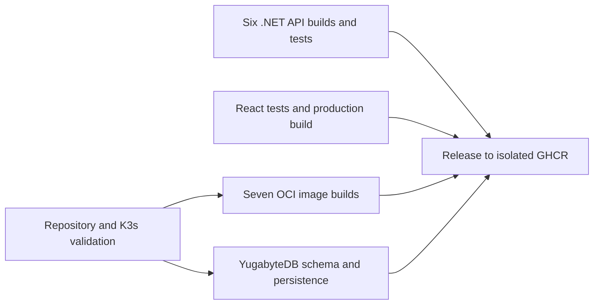

# TaskForge K3s: CI/CD release gate

**Target:** `cluster-v2`, `k3s-*` and `k3s/**` only. The workflow is
`.github/workflows/k3s-sandbox-ci.yml` and never deploys to a server.
Its only publish destination is
`ghcr.io/<owner>/taskforge-k3s-lab/<component>:<commit-sha>`.

## Release graph



The jobs for API builds and React run independently from the Kubernetes
preflight. The container build matrix and the database integration test start
once the preflight succeeds. The release matrix starts **only if every required
job succeeds**; the resulting images are tagged by the exact commit SHA.
There are no SSH credentials, deployment secrets, production endpoints, or
`:develop`/`:latest` tags in this workflow.

## YugabyteDB smoke test

`scripts/ci/yugabyte-smoke.sh` owns the disposable CI database lifecycle.
The workflow uses its commands in this order:

| Command | Purpose |
|---|---|
| `start` | Pull pinned image, start an RF=1 Docker container, wait for YSQL connectivity |
| `create` | Run the isolated `taskforge_k3s_*` logical-database bootstrap |
| `migrate` | Apply EF migrations sequentially for six service databases |
| `verify` | Check migration history, domain tables, and real INSERT/SELECT on each database |
| `diagnose` | On failure, capture process status, memory, filtered startup output and internal logs |
| `cleanup` | Always destroy the disposable CI-only container |

**Connection rule:** `yugabyted` running in Docker binds YSQL to its container
hostname/IP, so in-container `ysqlsh` must target that hostname, **not**
`127.0.0.1`. The script starts Docker with an explicit `--hostname` and uses it
for all `docker exec ... ysqlsh` commands. The .NET processes run on the GitHub
runner, outside the container, and therefore connect through the loopback-only
published port `127.0.0.1:15433` instead.

Readiness is bounded to seven minutes, each query is bounded to ten seconds,
and progress is printed periodically. The first failed health check is not
interpreted as a database failure; health checks retry while the container is
running. If the container exits or the deadline is reached, the job fails with
an explicit GitHub annotation and a downloadable `taskforge-ysql-diagnostics`
artifact. A successful container process is not sufficient: `SELECT 1` and
`SELECT version()` must both succeed.

The job uses the same YugabyteDB **2026.1.2** release family as the K3s
Helm chart defaults. It is an integration test of YSQL and EF, not a Kubernetes
installation test. Kubernetes deployment is separately verified on the local PC.

## Failure triage

**`01 | Repository & Kubernetes validation` failed:** open the first failing
step. It prints missing/forbidden paths, Docker context mismatches or a
Kubernetes validation error. Do not disable the branch-isolation check.

**`03 | YugabyteDB - schema & persistence` failed in `start`:** download
`taskforge-ysql-diagnostics`; inspect `summary.txt` for container state,
`oom_killed`, last readiness error, and YB server logs. A spinning Docker
startup banner is not evidence of YSQL readiness. No migration has run.

**Database `create` failed:** inspect SQL/bootstrap permissions and messages;
this affects only the temporary CI database.

**Database `migrate` failed:** read the visible diagnostic excerpt **after**
the collapsed `EF Core | <service>` log group. Download the
`taskforge-ysql-diagnostics` artifact and open `ef-<service>.log` for the complete
.NET exception or failed SQL statement. A startup/configuration failure can
happen before any DDL is attempted; distinguish it from an unsupported YSQL
migration. Do not mark the job successful or bypass schema verification. The
existing Npgsql migration history override is restricted to single-run jobs.

**Database `verify` failed:** read the printed database name and failed assertion.
All six databases must have migration history, application tables and working
INSERT/SELECT, rather than only checking the `yugabyte` bootstrap database.

**`03 | OCI image build` failed:** inspect the Docker build action's build record.
The runtime image build uses the same Dockerfile and context as the local K3s lab.

**`04 | GHCR release` skipped:** one of the required jobs failed or was skipped.
That is an intentional release gate, not an independent failure.

## Branch-specific local verification

These local scripts run the isolated K3s checks only; removed production
Compose and develop workflows are never required.

```bash
# Python, Node, shell, migration history, ownership and both K3s profiles:
bash scripts/tests/repository.sh

# In addition: .NET 10 Release builds/tests for six APIs, frontend Node tests,
# and native SQL Go gate (requires compiler and client libraries):
bash scripts/tests/fast.sh

# In addition: React production bundle and temporary YugabyteDB RF1
# with six EF migration sets (requires Docker and .NET 10):
bash scripts/tests/all.sh
```

The full suite creates a **new** disposable Docker database, never touches a
running K3s PVC, and refuses to reuse or delete a Docker container without its
own `taskforge.io/k3s-ci` ownership label. Passing portable source checks alone does not establish working .NET APIs or a valid YugabyteDB schema.
See `docs/architecture/TASK_DATA_OWNERSHIP.md` for the current owner boundary. Runtime readiness requires passing EF model-drift and disposable YugabyteDB checks.

## Local PC (separate from GitHub)

The GitHub Actions build does **not** connect to a home PC, VPS or running
TaskForge instance. For local one-node K3s, follow `docs/operations/README_K3S_BRANCH.md` and
`infrastructure/k8s/taskforge-yugabyte/local/START_LOCAL_RU.md`.
That deployment has persistent PVCs and is intentionally not destroyed by CI.
Its YugabyteDB RF=1 profile is not fault tolerant.

## Проверка готовности

До первого локального запуска из корня проекта создать EF-миграции:

```bash
bash scripts/generate-migrations.sh ConsolidateAttempts tasks,solutions
```

CI должен отклонять код, если EF-модель и snapshot расходятся.
Это обязательный блокирующий этап, а не косметический warning.
Даже успешные статические проверки не доказывают работоспособность
пяти типов заданий и удалений в настоящей YugabyteDB.
